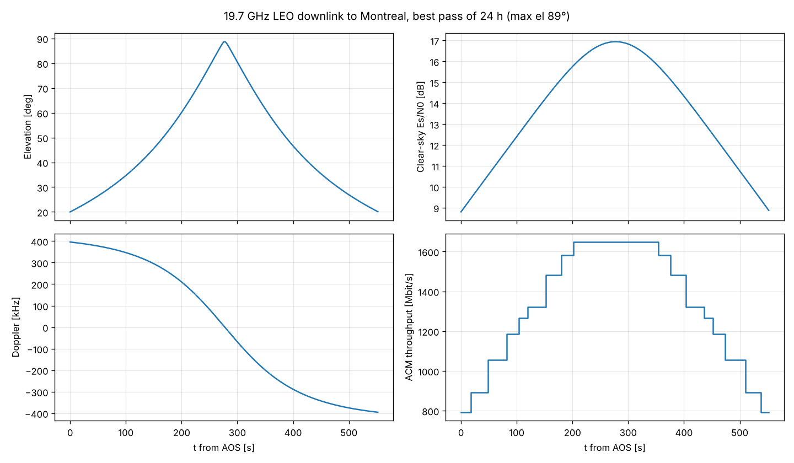

# linkbudget

Satellite RF link budgets built from ITU-R Recommendations, with DVB-S2 adaptive coding and modulation (ACM) and Doppler over real passes.

This is the analysis that communications payload engineering starts from. MDA Space's Sainte-Anne-de-Bellevue site builds satellite payloads, antennas and electronics, including the Ka-band payloads for Telesat Lightspeed.

## What it does

| Module | Content |
|---|---|
| `itu.py` | ITU-R P.838-3 rain coefficients $k$ and $\alpha$ for any polarisation tilt $\tau$ and elevation $\theta$, giving $\gamma_R = kR^\alpha$. The full ITU-R P.618-13 §2.2.1.1 rain-attenuation procedure (steps 1–10, including the $p$ % scaling). Sky noise from attenuation, $T_{sky} = T_m(1-10^{-A/10}) + T_{CMB}10^{-A/10}$. |
| `link.py` | FSPL $20\log_{10}(4\pi d f/c)$, dish gain $\eta(\pi D/\lambda)^2$, beamwidth and pointing loss, system temperature with a lossy feed, and the $C/N_0$, $E_s/N_0$ budget with $10\log_{10}k_B = -228.60$ dBW/(K·Hz). |
| `dvbs2.py` | All 28 DVB-S2 MODCODs from ETSI EN 302 307-1 Table 13 (QEF $E_s/N_0$ and spectral efficiency), and ACM selection with margin and implementation loss. |
| `doppler.py` | $f_D = -f_0\dot\rho/c$ and $\dot f_D$ over a pass, with geometry from `orbitkit`. |
| `noise.py` | Noise temperature $T_e = T_0(F-1)$, the Friis cascade, and passive loss $T_e = (L-1)T_p$. |
| `optical.py` | Gaussian-beam optics: $z_R = \pi w_0^2/\lambda$, $w(z)$, divergence $\lambda/\pi w_0$, aperture capture $1 - e^{-2a^2/w^2}$, and an angular-spectrum propagator. |
| `qkd.py` | BB84 with polarisation qubits, using Born-rule measurements on state vectors and intercept-resend attacks, plus the decoy-state secret key rate (Lo-Ma-Chen 2005). |

## Course concepts used

| Course | Where |
|---|---|
| PHYS 301 Electricity and Magnetism | FSPL (inverse-square spreading), antenna gain, polarisation |
| PHYS 403 Statistical Mechanics | $k_BTB$ noise, sky brightness temperature from radiative transfer, noise temperature |
| PHYS 408 Optics (diffraction, Gaussian beams, Fourier optics) | Dish gain and beamwidth, `optical.py`, angular-spectrum propagation |
| PHYS 304 Quantum Mechanics | BB84 states, measurement, basis mismatch, QBER |
| PHYS 200 Relativity | Doppler $f_D = -f_0\dot\rho/c$ (first order in $\beta$) |
| MATH 316 Fourier methods | Angular spectrum (2-D FFT) propagation |

## Validation (`pytest`, 31 tests)

| Check | Reference | Result |
|---|---|---|
| P.838-3 $k_H, \alpha_H, k_V, \alpha_V$ at 10, 20 and 30 GHz | tabulated values in P.838-3 | within 0.2 % |
| P.618-13 $A_p$, 6 cases (12–30 GHz, 8–45° elevation, $p$ from 0.01 % to 1 %) | independent `itur` implementation (del Portillo et al.) | relative error $10^{-9}$ |
| Every DVB-S2 threshold above the Shannon bound $2^\eta - 1$ | Shannon | holds |
| FSPL for GEO at 12 GHz = 205.15 dB, and dish gain | textbook | within 0.01 dB |
| Doppler sign change at TCA, peak $\lvert\dot f_D\rvert$ at TCA, and $\lvert f_D\rvert < f_0 v/c$ | physics | holds |
| Friis: $T_e$ and NF cascades agree; passive NF = loss; 1 dB before a 0.8 dB LNA raises $T_e$ from 59 K to 149 K | textbook | within $10^{-12}$ and 0.05 K |
| Angular-spectrum propagation of a Gaussian to $2z_R$ vs. $w(z)$; power conserved | — | within 0.1 %; relative error $10^{-9}$ |
| BB84: no Eve gives 0 errors; intercept-resend gives 25 % QBER; misalignment $\theta$ gives $\sin^2\theta$ | quantum theory | within 1.5 % |
| Shor-Preskill threshold $1 - 2h(e) = 0$ | 11.0 % | within 0.05 % |

## Run

```bash
pip install -e ../orbitkit -e .[dev]
pytest
python examples/leo_ka_downlink.py
python examples/qkd_downlink.py     # 785 nm decoy-state QKD over a pass: 32-40 dB loss, about 800 kbit of key
```

The example is a 19.7 GHz user downlink from a 1015 km polar LEO satellite to a 0.6 m terminal in Montreal. It prints the clear-sky budget table, the throughput selected by ACM over the best pass of the day, and an availability table. That table uses rain fade for this site from the ITU maps: $R_{0.01} = 32.9$ mm/h and $h_0 = 3.22$ km.



## Modelling notes

Gaseous and cloud attenuation is a typical zenith value at 19.7 GHz scaled by $1/\sin\theta$, rather than the full P.676 line-by-line model. Payload EIRP and terminal values are illustrative design numbers, not the specification of any flight system.
