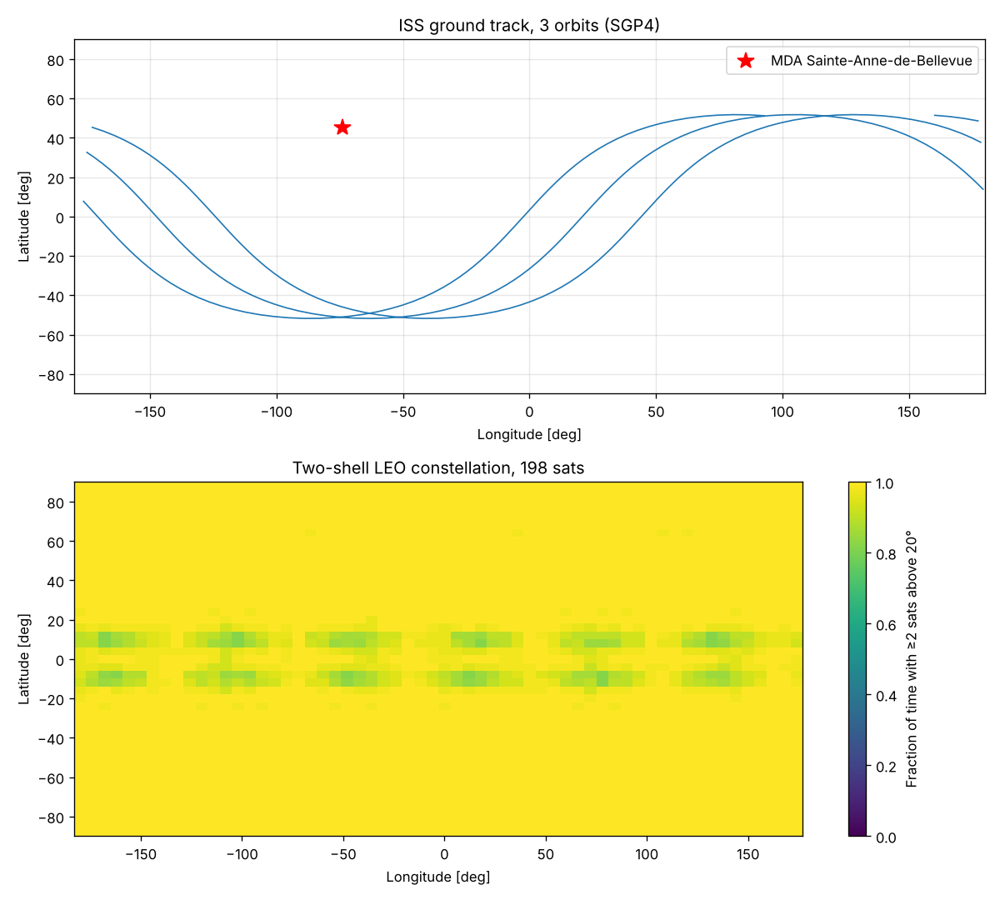

# orbitkit

Orbit propagation, reference frames, ground-station pass prediction and LEO constellation coverage in Python. The code is validated against published reference values.

This is the flight dynamics layer that satellite operations and constellation design depend on, such as the Telesat Lightspeed constellation whose payloads MDA Space builds in Sainte-Anne-de-Bellevue, or MDA AURORA software-defined satellites.

## What it does

| Module | Content |
|---|---|
| `tle.py` | SGP4/SDP4 propagation of TLEs, using the Vallado 2006 reference implementation (`sgp4`) with WGS-72 constants. You can also build a satellite from design mean elements. |
| `timeutil.py` | Julian date, and IAU-82 GMST $\theta_{GMST}(T_{UT1})$. |
| `frames.py` | TEME → PEF, $r_{PEF} = R_3(\theta_{GMST})\,r_{TEME}$ and $v_{PEF} = R_3 v_{TEME} - \omega_\oplus \times r_{PEF}$. Also WGS-84 geodetic ↔ ECEF, ENU look angles, and range rate $\dot\rho$. |
| `kepler.py` | Classical elements ↔ state vectors, and a Kepler equation solver $M = E - e\sin E$. |
| `j2.py` | Analytic J2 secular rates $\dot\Omega = -\tfrac32 nJ_2(R_\oplus/p)^2\cos i$, $\dot\omega$ and $\dot M$, plus sun-synchronous inclination. Cowell integration (DOP853) of $\ddot r = -\mu r/\lvert r\rvert^3 + a_{J_2}$. |
| `passes.py` | AOS, TCA and LOS with an elevation mask. Crossings are refined by Brent's method to 1 ms. |
| `coverage.py` | Walker-delta $i{:}T/P/F$ shells with J2 drift, Earth central angle $\lambda = \tfrac{\pi}{2} - \varepsilon - \arcsin\!\left(\tfrac{R_\oplus}{R_\oplus+h}\cos\varepsilon\right)$, and $k$-fold coverage maps. |
| `od.py` | Batch least-squares orbit determination from range and range-rate tracking: $\delta x = (H^TWH)^{-1}H^TW\delta y$, covariance $P = (H^TWH)^{-1}$, and $\chi^2$ consistency checks. |
| `relativity.py` | GPS clock corrections. The fractional rate is $\frac{\Delta f}{f} = \frac{W_0}{c^2} - \frac{3\mu}{2ac^2}$, and the eccentricity term is $\Delta t_r = Fe\sqrt{a}\sin E$ with $F = -2\sqrt{\mu}/c^2$. |
| `sun.py` | Solar ephemeris (Astronomical Almanac), beta angle, and a conical umbra/penumbra shadow function. |
| `j2.py` | Also the potential $U = -\frac{\mu}{r}[1 - J_2(R/r)^2P_2(\sin\phi)]$, with $\ddot r = -\nabla U$. |

## Course concepts used

| Course | Where |
|---|---|
| PHYS 216 Intermediate Mechanics (central forces, non-inertial frames) | Two-body and J2 dynamics, rotating-frame transforms in `frames.py` |
| MATH 217 Vector calculus | $a_{J_2} = -\nabla U$, checked by finite differences, and the curl-free Jacobian test |
| MATH 215 Differential equations | Cowell integration of $\ddot r = f(r)$ |
| PHYS 200 Relativity | GPS clock offsets: +45.7 µs/day gravitational, −7.2 µs/day kinematic |
| PHYS 229 Data analysis, PHYS 210 Computational physics | Weighted least squares, covariance, $\chi^2$ tests |
| ASTR 205 Stars (positions, coordinates) | Solar position, ecliptic to equatorial coordinates, the Sun's angular size in the penumbra model |

## Validation (`pytest`, 33 tests)

| Check | Reference | Result |
|---|---|---|
| SGP4 satellite 00005 at $t = 0$ and 360 min | Vallado et al. 2006, AIAA 2006-6753, `tcppver.out` | within 1 mm and 1 mm/s |
| TEME → PEF | Vallado 2006 Appendix C example | within 1 mm and 0.01 mm/s |
| GMST, 1992-08-20 12:14 UT1 | Vallado, *Fundamentals* 4th ed., Ex. 3-5 | within $10^{-8}$ deg |
| Elements → $r$, $v$ | Vallado Ex. 2-6 | within 2 m |
| Numerical J2 RAAN drift vs. secular theory, ISS orbit, 5 days | first-order theory | within 0.5 %; about −5.0 deg/day |
| Sun-synchronous inclination at 800 km | standard value 98.6° | within 0.05° |
| Two-body energy conservation over 1 day | — | $\lvert\Delta E\rvert < 10^{-10}$ km²/s² |
| Range rate vs. finite difference of range | — | within 0.1 m/s |
| GPS clock rate +38.6 µs/day; factory frequency 10.22999999543 MHz; $F = -4.442807633\times10^{-10}$ | IS-GPS-200 | within 0.1 µs/day, $10^{-5}$ Hz, and relative error $10^{-9}$ |
| Sun position, 2006-04-02 | Vallado Ex. 5-1 | within $5\times10^{-6}$ AU |
| Solar declination at the 2024 equinox and solstices | 0°, ±23.436° | within 0.01° |
| Conical-shadow eclipse fraction vs. the cylindrical formula, $\beta = 0$ | $\arcsin(R/a)/\pi$ | within 0.2 % |
| Batch OD from 4 stations over 6 h, 10 m and 1 cm/s noise | — | converges from 6 km error to 0.25 m; $\chi^2/\nu = 1.10$ for $\nu = 432$; NEES < $\chi^2_6$ 99.9 % bound |

## Run

```bash
pip install -e .[dev]
pytest
python examples/demo.py   # ISS passes over Sainte-Anne-de-Bellevue, ground track, constellation coverage map
```



## Modelling notes

- UTC is used for UT1, which gives less than 0.4 km of along-track error. Polar motion (under 15 m) is neglected, so "ECEF" here means PEF.
- Coverage uses a spherical Earth for visibility. The two-shell, 198-satellite constellation in the demo is illustrative of a Lightspeed-class design and does not use Telesat's flight parameters.
- Inertial frames are realisations of the ICRF, whose axes are fixed by VLBI positions of distant quasars (ASTR 300). TEME and mean-of-date are approximations to it that precess and nutate, and `sun.py` works in mean-of-date coordinates.
