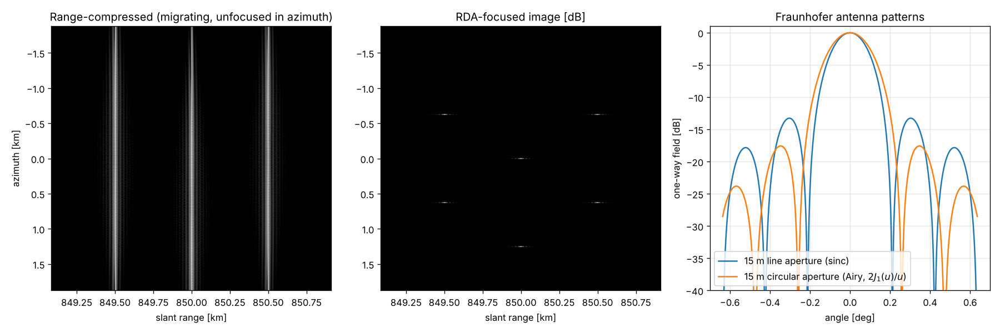

# sarsim

A synthetic aperture radar simulator that works from first principles. It starts from Fraunhofer diffraction at the antenna, then builds chirp pulse compression and the radar equation, and finishes with a focused image from the Range-Doppler Algorithm.

MDA Space built RADARSAT-1 and RADARSAT-2 and is the prime contractor for the RADARSAT Constellation Mission, so SAR is its signature Earth-observation technology.

## What it does

| Module | Physics and math | Course |
|---|---|---|
| `antenna.py` | The far field is the Fourier transform of the aperture. A line aperture gives $\mathrm{sinc}(L\sin\theta/\lambda)$ with half-power beamwidth $0.886\lambda/L$. A circular aperture gives the Airy pattern $2J_1(u)/u$, whose first null at $u = j_{1,1} = 3.8317$ is a zero of the Bessel function. Gain is $4\pi A/\lambda^2$. | PHYS 408 (diffraction, Fourier optics), MATH 316 (Bessel's equation) |
| `chirp.py` | LFM pulse $e^{i\pi Kt^2}$, the matched filter $h(t) = s^*(-t)$, and the compressed width $0.886/B$, PSLR −13.26 dB and SNR gain $TB$. The stationary-phase spectrum is $S(f) \approx K^{-1/2}e^{-i\pi f^2/K + i\pi/4}$. | MATH 300 (asymptotics of complex integrals), MATH 316 (Fourier) |
| `radar.py` | Radar equation $P_r = P_tG^2\lambda^2\sigma/((4\pi)^3R^4)$, thermal noise $k_BTB$, image SNR after coherent integration over $T_a = \lambda R/(L_aV)$, and the NESZ that follows from it. | PHYS 301 (radiation, Poynting flux), PHYS 403 (Johnson noise) |
| `rda.py` | Point-target raw data along the hyperbolic range history $R(\eta) = \sqrt{R_0^2 + V^2\eta^2}$. Focusing has four steps: range compression, then azimuth FFT, then range cell migration correction by $R_0(1/D - 1)$ with $D = \sqrt{1 - (\lambda f_\eta/2V)^2}$, then the azimuth matched filter. | PHYS 301 (EM wave phase), PHYS 210 (FFT methods) |

## Validation (`pytest`, 12 tests)

| Check | Result |
|---|---|
| Half-power beamwidth of $\mathrm{sinc}^2$ is $0.8859\lambda/L$; Airy first null at $1.2197\lambda/D$ and HPBW $1.029\lambda/D$ | within $10^{-4}$ |
| FFT of a sampled aperture equals the analytic sinc pattern | within $2\times10^{-3}$ |
| Pulse compression: width $0.886/B$, PSLR −13.26 dB, ISLR −9.7 dB, SNR gain $T f_s$ | within 1 %, 0.15 dB, 0.4 dB and 0.2 dB |
| Stationary-phase spectrum vs. exact FFT of a $TB = 600$ chirp | amplitude within 2 %, RMS phase < 0.1 rad |
| NESZ is exactly the $\sigma^0$ that gives SNR = 1 in a resolution cell | relative error $10^{-12}$ |
| Focused targets land at their true $(R_0, \eta_c)$ | within 1 sample |
| Range resolution and PSLR after full 2-D focusing | within 1 % of $0.886c/2B$, and −13.26 ± 0.2 dB |
| Azimuth resolution vs. an independent prediction from the antenna-limited Doppler spectrum | within 1 % |
| Relative amplitude and the phase $-4\pi f_0R_0/c$ preserved (needed for interferometry) | within 2 % and 0.1 rad |
| Image SNR vs. the matched-filter theorem, after the computed mismatch loss of a phase-only azimuth filter | within 0.2 dB |

## Run

```bash
pip install -e .[dev]
pytest
python examples/demo.py
```

The demo uses RADARSAT-2-class parameters: 5.405 GHz, a 15 m antenna and a 30 MHz chirp. Its measured slant-range resolution is 4.43 m against 4.43 m from theory, with PSLR −13.28 dB, and the NESZ comes out at −26.9 dB.



## Modelling notes

The geometry is a straight-line, zero-squint stripmap with an effective velocity $V_r$. RCMC uses the scene-centre range, which is exact for a scene this size. Secondary range compression is negligible here, because the coupling term scales with $cR_0f_\eta^2/(2V^2f_0^3)$ and is about $10^{-5}$. The system parameters are representative, not flight values.
