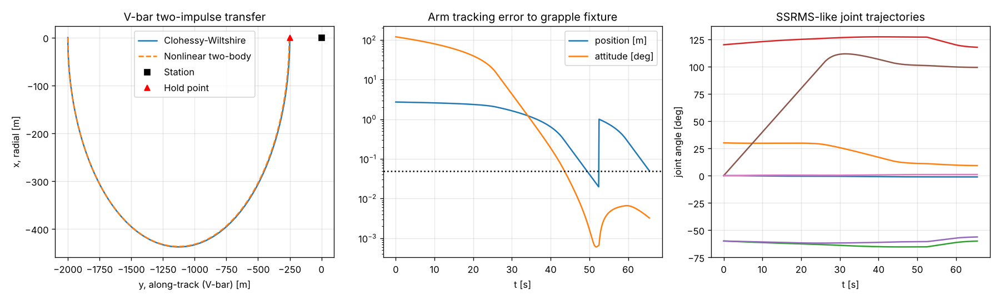

# spacearm

Space manipulator kinematics and control, plus rendezvous and proximity operations (RPO) guidance. Together they cover the full chain behind a Canadarm2 capture of a visiting vehicle: a V-bar approach to a hold point, followed by free drift and capture with a 7-DOF arm.

MDA Space built Canadarm, Canadarm2 (SSRMS) and Dextre, and is building Canadarm3 for the Lunar Gateway.

## What it does

| Module | Content |
|---|---|
| `manipulator.py` | Standard DH kinematics, $^{i-1}T_i = R_z(\theta_i)T_z(d_i)T_x(a_i)R_x(\alpha_i)$. Geometric Jacobian $J_i = [z_{i-1}\times(p_e-p_{i-1});\ z_{i-1}]$. Yoshikawa manipulability $\sqrt{\det JJ^T}$. Damped least squares $\dot q = J^T(JJ^T+\lambda^2I)^{-1}e + (I-J^+J)z$ with null-space joint-limit avoidance, and iterative IK with Levenberg-Marquardt damping. |
| `ssrms_like()` | A 7-DOF, symmetric, offset-joint arm with SSRMS's joint sequence (shoulder roll, yaw, pitch; elbow pitch; wrist pitch, yaw, roll), two 6.85 m booms, ±270° joints and 4 °/s rate limits. **Approximate geometry, not flight data.** |
| `proximity.py` | Clohessy-Wiltshire state transition matrix $\Phi(t)$, two-impulse targeting to a hold point, the drift-free condition $\dot y_0 = -2nx_0$, and a nonlinear two-body truth model in the Hill frame. |
| `capture.py` | An ISS-style capture. The vehicle drifts about 10 m below the arm base under CW dynamics with a residual attitude rate. The arm tracks the grapple fixture with feed-forward resolved-rate control: it moves to a 1 m pre-grasp standoff and then closes. Tip speed and joint rates are saturated. |

## Validation (`pytest`, 30 tests)

| Check | Reference | Result |
|---|---|---|
| CW STM equals $e^{At}$, and $\Phi(t_1)\Phi(t_2) = \Phi(t_1+t_2)$ | linear systems theory | within $10^{-9}$ |
| Radial-impulse V-bar hop, $\lvert\Delta v\rvert = n\Delta y/4$ per impulse | Fehse, *Automated Rendezvous and Docking of Spacecraft*, sec. 3.3 | relative error $10^{-9}$ |
| Drift-free 2:1 relative ellipse closes after one orbit | CW | within $10^{-8}$ m |
| Along-track drift of a radial offset, $\lvert\Delta y\rvert = 12\pi\lvert x_0\rvert$ per orbit | CW closed form | exact |
| CW vs. nonlinear two-body at about 100 m, over one orbit | — | < 1 m |
| Jacobian vs. central finite differences, random configurations | — | within $10^{-6}$ |
| 2R planar arm FK, and singularity $\det J = l_1l_2\sin q_2$ | closed form | exact |
| Null-space motion leaves the end effector fixed | $J(I-J^+J)=0$ | within $10^{-10}$ |
| DLS bound at a singularity, $\lVert\dot q\rVert \le \lVert e\rVert/2\lambda$ | Wampler 1986 | holds |
| IK on random reachable poses | — | converges to $< 10^{-5}$ |
| Capture with mm/s residual drift | — | captured within the joint-rate limits |

## Run

```bash
pip install -e .[dev]
pytest
python examples/demo.py
```



## Modelling notes

The station holds an LVLH attitude and is far more massive than the visiting vehicle, so the arm is fixed-base. The capture envelope (5 cm, 2°) is an assumed value. Hill frame axes: $x$ is radial, $y$ is along-track and $z$ is orbit normal. NASA's ISS LVLH convention maps to these as $x_{ISS} = y$ and $z_{ISS} = -x$.
