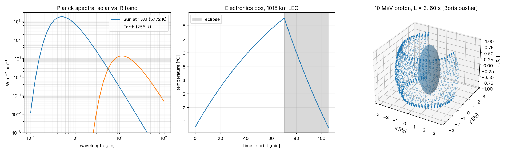

# spaceenv

The thermal and charged-particle environment that spacecraft and their electronics are designed against. It covers radiative heat balance, conduction, thermal noise, and particle motion in the radiation belts.

MDA Space's Sainte-Anne-de-Bellevue site designs satellite electronics and payloads. Their thermal design and radiation tolerance (total dose and single-event effects) both start from this physics.

## What it does

| Module | Physics and math | Course |
|---|---|---|
| `thermal.py`: radiation | Planck's law $B_\lambda = \frac{2hc^2}{\lambda^5}\frac{1}{e^{hc/\lambda k_BT}-1}$. Stefan-Boltzmann with $\sigma = \frac{2\pi^5k_B^4}{15h^3c^2}$ from $\int_0^\infty\frac{x^3}{e^x-1}dx = \Gamma(4)\zeta(4) = \pi^4/15$. Wien's constant from $x = 5(1-e^{-x})$, solved exactly with the Lambert W function. The solar constant from the Sun's $T_{eff}$. | PHYS 403 (photon gas, blackbody), PHYS 203, ASTR 205 (stellar temperatures) |
| `thermal.py`: balance | Isothermal radiative balance $\alpha SA_s + \alpha aSFA + \varepsilon q_{IR}FA + Q = \varepsilon\sigma AT^4$, Earth view factors, and an RK4 orbit transient with eclipses. | PHYS 203, MATH 215 (nonlinear ODE) |
| `thermal.py`: conduction | Heat equation $u_t = \kappa u_{xx}$. The exact Fourier sine series comes from separation of variables, cross-checked against a Crank-Nicolson solver. | MATH 316 (separation of variables, heat flow), PHYS 210 (numerical methods) |
| `thermal.py`: noise | Johnson-Nyquist PSD with the quantum correction $\frac{hf}{e^{hf/k_BT}-1}$. It tends to $k_BT$ at radio frequencies and is suppressed by $e^{-32}$ at 1550 nm. | PHYS 403 (fluctuations), PHYS 304 |
| `radiation.py` | The dipole field $B = \frac{B_0}{r^3}\sqrt{1+3\sin^2\lambda}$, relativistic gyration, mirror points from conservation of $\mu = p_\perp^2/2mB$, loss cones, and Störmer cutoff rigidity $R_c = \frac{cB_0R_E}{4}\frac{\cos^4\lambda}{r^2}$. A relativistic Boris integrator of $\frac{d(\gamma m\mathbf v)}{dt} = q\mathbf v\times\mathbf B$ checks the guiding-centre bounce and drift periods. | PHYS 301 (magnetostatics, Lorentz force), PHYS 200 (relativistic momentum), ASTR 406 (charged particles in astrophysical fields), PHYS 210 |

## Validation (`pytest`, 23 tests)

| Check | Reference | Result |
|---|---|---|
| $\sigma$ computed from $h$, $k_B$ and $c$ | CODATA 2018 | relative error $10^{-9}$ |
| $\int \pi B_\lambda d\lambda = \sigma T^4$ by quadrature | — | relative error $10^{-4}$ |
| Wien constant | CODATA 2018, $2.897771955\times10^{-3}$ m K | relative error $10^{-9}$ |
| Solar constant from $T_\odot = 5772$ K | IAU 2015, 1361 W/m² | within 0.2 % |
| Earth effective temperature with albedo 0.30 | 255 K | within 0.3 K |
| Blackbody sphere at 1 AU | $(S/4\sigma)^{1/4} = 278.3$ K | exact |
| Heat equation: series vs. Crank-Nicolson; late decay rate $\kappa\pi^2/L^2$ | — | within 2 mK; relative error $10^{-6}$ |
| Johnson noise of 1 kΩ at 290 K over 1 MHz | 4.0 µV rms | within 1 % |
| Boris pusher energy conservation (pure B field) | — | $10^{-10}$ |
| 10 MeV proton at $L = 3$: full-orbit bounce and drift periods vs. guiding-centre formulas (Hamlin 1961) | — | within 4 % (finite gyroradius about 2 % of $LR_E$) |
| Westward proton drift, mirror latitude | — | sign correct; within 1.5° |

## Run

```bash
pip install -e .[dev]
pytest
python examples/demo.py
```

The demo prints a 1015 km LEO electronics box swinging between about 0 °C and 9 °C over an orbit with a 33 % eclipse. It also integrates a trapped proton for 60 s.


